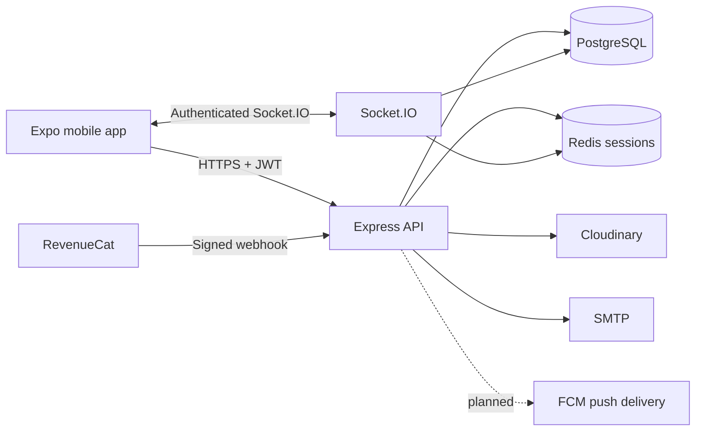

# Worker

Worker is a mobile marketplace where customers publish local service requests and eligible workers submit private offers. A customer selects one offer, the assigned worker completes the job, and the customer may leave a verified review.

## Main Features

- Customer and worker registration, JWT sessions, refresh rotation, and password recovery
- Worker profile, categories, availability, city/radius matching, and onboarding
- Customer requests with images, scheduling, duplicate protection, and status history
- Up to five concurrent worker offers with private offer conversations
- Assigned-job chat over REST and Socket.IO
- Worker Pro access and quota accounting through a RevenueCat-backed abstraction
- Reviews tied to completed requests, notifications, favorites, and admin operations
- English, Arabic, Hebrew, and Russian mobile localization

## Technology

| Area | Stack |
| --- | --- |
| Mobile | React Native, Expo 54, React Navigation, React Query, Zustand |
| API | Node.js 20, Express, TypeScript, Zod |
| Data | PostgreSQL, Prisma |
| Sessions | Redis |
| Realtime | Socket.IO |
| External services | RevenueCat, Cloudinary, SMTP; FCM integration pending |
| Deployment | Docker, Render, GitHub Actions |

## Architecture



The API derives identity and role from JWTs and validates the active session in Redis. PostgreSQL remains authoritative for requests, offers, quota usage, subscriptions, reviews, chats, and notifications. See [Architecture](docs/ARCHITECTURE.md) and [API overview](docs/API.md).

## Repository

```text
backend/              Express API, Prisma schema, migrations, tests
mobile/               Expo application and localization
docs/                 Architecture, API, testing, deployment documentation
.github/workflows/    Verification-only CI
docker-compose.yml    Local development PostgreSQL, Redis, and API
docker-compose.test.yml  Isolated ephemeral integration services
render.yaml           Render service configuration
```

## Local Setup

Requirements: Node.js 20, npm, Docker Desktop, and Expo Go for physical-device testing.

```bash
git clone <repository-url>
cd worker-auth-4-fixed-clean
cp backend/.env.example backend/.env
cp mobile/.env.example mobile/.env.local
npm ci --prefix backend
npm ci --prefix mobile
docker compose up -d postgres redis
cd backend
npx prisma migrate deploy
npx prisma db seed
npm run dev
```

In a second terminal:

```bash
cd mobile
npx expo start --go --lan -c
```

Use `--tunnel` when the phone cannot reach the Mac over the local network. The mobile API and socket URLs are public Render URLs and do not require the local backend for normal phone testing.

## Environment

Backend variables are documented in `backend/.env.example`. Generate independent JWT secrets with `openssl rand -hex 32`. Never commit `.env` files. Production requires PostgreSQL, Redis, `CLIENT_URL`, SMTP, and Cloudinary configuration. RevenueCat remains disabled until its project, entitlement, bearer token, and optional signing secret are configured.

Mobile public configuration:

```env
EXPO_PUBLIC_API_URL=https://worker-auth.onrender.com/api/v1
EXPO_PUBLIC_SOCKET_URL=https://worker-auth.onrender.com
```

`EXPO_PUBLIC_*` values are bundled into the app and must never contain private credentials.

## Database and Migrations

Use development migrations only against a local development database:

```bash
cd backend
npx prisma validate
npx prisma generate
npx prisma migrate dev
```

Production and CI use forward-only deployment:

```bash
npx prisma migrate deploy
```

Never run `prisma migrate reset` against shared or production data.

## Verification

```bash
cd backend
npx prisma validate
npm run build
npm test
npm audit --omit=dev

# Starts isolated Docker services, runs migrations/tests, and always removes them
npm run test:integration:docker

cd mobile
npm run typecheck
npm run i18n:check
npx expo install --check
npx expo-doctor
```

The integration runner refuses non-local databases, requires a database name ending in `_test`, and uses Redis database 15. See [Testing](docs/TESTING.md).

## Security Design

- HS256 JWTs require issuer, audience, session ID, expiration, and role claims.
- Refresh tokens are stored as SHA-256 digests and rotated atomically in Redis.
- Password changes, reset, logout, and suspension revoke REST and socket sessions.
- Zod schemas reject over-posted and malformed request data.
- Privacy serializers separate customer, assigned-worker, public-worker, and admin views.
- Offer/message access is participant-scoped; request mutations share a stable advisory lock.
- Uploads have count, size, MIME, and signature checks with failed-upload cleanup.
- API responses are non-cacheable and operational logs redact sensitive fields.

## Deployment

Render builds `backend/Dockerfile`, executes `npx prisma migrate deploy` before starting, and checks `/health`. `/ready` additionally verifies PostgreSQL and Redis. GitHub Actions verifies code but does not deploy. See [Production checklist](docs/PRODUCTION_CHECKLIST.md).

## Known Limitations

- FCM push delivery is not implemented; notifications persist in PostgreSQL and emit over Socket.IO.
- Socket.IO uses an in-memory adapter and therefore assumes one backend instance.
- Service-area matching uses city and Haversine/bounding-box logic without PostGIS.
- Credentialed SMTP, Cloudinary, RevenueCat, and app-store purchase flows require staging verification.
- Mobile runtime flows still need device-level automated end-to-end coverage.
