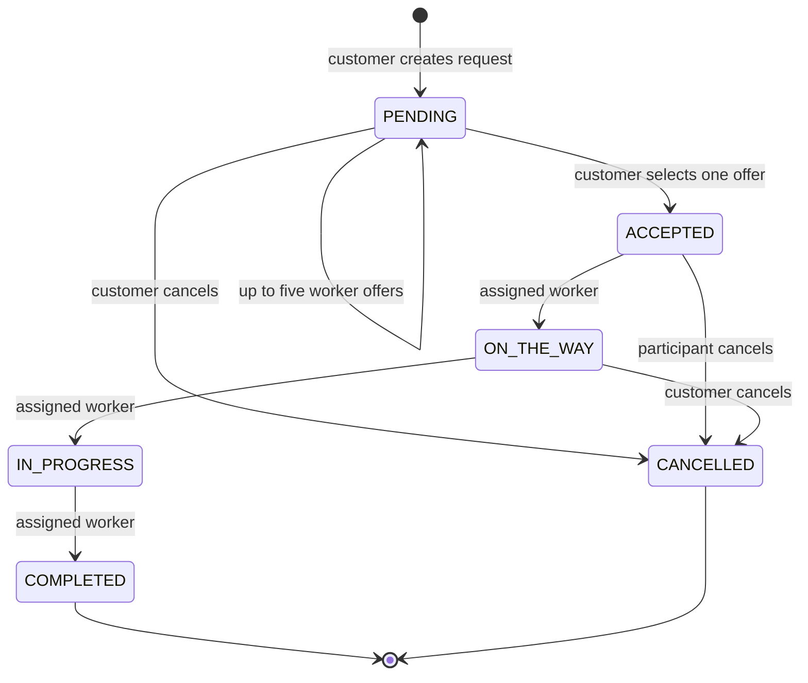

# Architecture and Core Flows

## Boundaries

- `mobile/src/services` owns HTTP clients; React Query owns server cache and Zustand stores only session/UI state.
- `backend/src/modules` separates routes, controllers, schemas, and services by domain.
- Prisma is the only application database client. Redis stores sessions, refresh-token digests, and single-use tokens.
- Socket.IO authenticates with the same access token and rechecks the Redis session on every incoming event.

## Authentication

1. Register/login validates input and bcrypt credentials.
2. The API creates one active session ID per account in Redis.
3. Access and refresh JWTs contain the session ID; only the refresh-token digest is stored.
4. Every protected HTTP call verifies JWT claims, active Redis session, user role, and active account.
5. Refresh rotation uses a Redis Lua script. Reuse revokes the session.
6. Password change/reset, logout, and admin suspension revoke Redis state and disconnect sockets.

## Request and Offer Lifecycle

Workers cannot directly accept pending requests. Offer creation does not consume quota. Customer confirmation assigns exactly one worker and records one free-usage row when applicable. Unselected offers become `NOT_SELECTED`; cancellation expires open offers.

## Concurrency

All mutations for one request acquire `pg_advisory_xact_lock(hashtext(requestId))` before reading mutable state. Lock order is always request lock followed by request/offer/quota writes. Transactions use `SERIALIZABLE`, conditional `updateMany` calls protect status transitions, unique indexes prevent duplicate active offers/reviews/usage, and webhook events have provider IDs for idempotency.

Parallel integration tests verify offer limits, double confirmation, withdrawal versus confirmation, cancellation versus confirmation, status races, and repeated cancellation against PostgreSQL.

## Privacy

Request serialization selects one of these views:

- Owning customer: full request and assigned worker details.
- Assigned worker: job contact and exact service location.
- Unselected matching/offer worker: public request area only, no customer/contact/exact coordinates.
- Admin: operational full view through role-protected routes.

Offer conversations are visible only to the owning customer and that offer's worker. Assigned-job chat is visible only to the customer and assigned worker. Public worker profiles omit email, phone, and base coordinates.

## Matching and Pagination

PostgreSQL filters pending requests by status, assignment, customer, category, and city/radius bounding box. The service performs exact Haversine and schedule checks on lightweight candidate rows, then fetches only full rows for the requested page. This avoids hydrating every broad request object while preserving exact totals and the existing no-location compatibility behavior.

## Operational Model

- `/health`: process liveness and build metadata.
- `/ready`: bounded PostgreSQL and Redis checks; returns 503 when either is unavailable.
- Every response carries `X-Request-ID`; logs are structured JSON and redact sensitive keys.
- SIGTERM/SIGINT stop Socket.IO, HTTP, Redis, and Prisma cleanly.
- Notification persistence failures are observable but never roll back the originating business operation.
